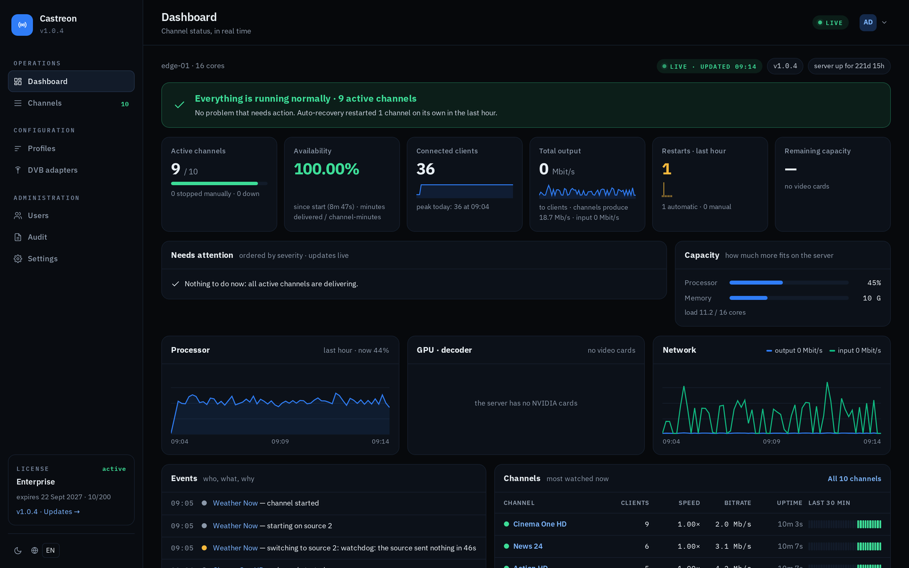
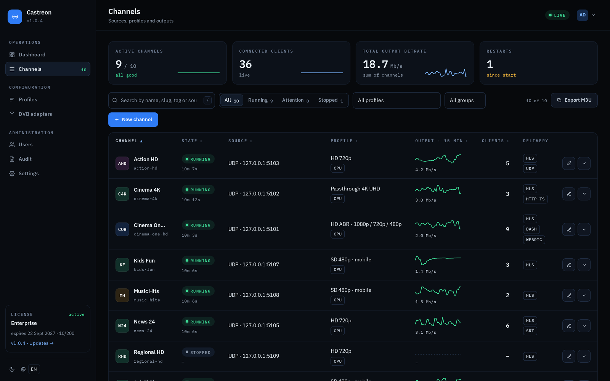
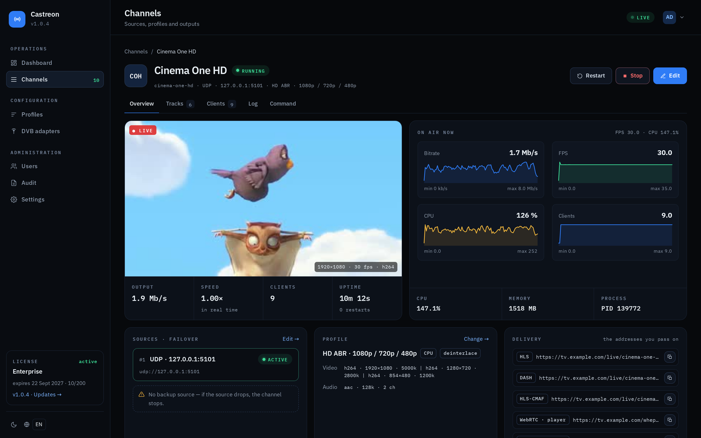
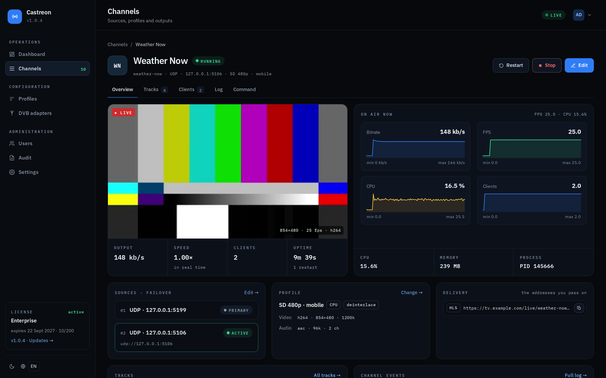

  

<h1 align="center">Castreon</h1>

  <b>The live TV headend that fits on one Linux server.</b> 
  Capture, transcode and deliver live channels from one web panel.

  <a href="https://castreon.net">Website</a> ·
  <a href="https://castreon.net/docs">Documentation</a> ·
  <a href="https://castreon.net/changelog">Changelog</a> ·
  <a href="https://castreon.net/start/trial">14-day free trial</a>

---

Castreon is a self-hosted live TV and streaming headend for Linux. It takes a channel from the input — a DVB card, an SRT or RIST feed, a camera, a file — through transcoding to the viewer, and you manage everything from one web panel.

> **About this repository:** Castreon is commercial software. This repository contains the public documentation, screenshots and links. The installer and the software itself are distributed from [castreon.net](https://castreon.net).

## What it does

**Inputs**
- DVB-C, DVB-T and DVB-T2 cards installed in the server
- SRT (caller and listener), RIST (Simple and Main), UDP unicast and multicast
- RTMP from OBS, vMix and hardware encoders, with per-channel stream keys
- HTTP/HTTPS (TS, HLS, DASH) and WebRTC (WHIP)
- IP cameras over RTSP, with ONVIF discovery and H.265 → H.264 conversion
- Files (MP4, MKV, TS) for 24/7 channels
- Automatic failover between sources and a "no signal" image

**Transcoding**
- CPU, or GPU with NVIDIA NVENC, Intel Quick Sync and VA-API
- H.264, HEVC and AV1, up to 4K UHD
- ABR ladders, logo overlay, loudness normalisation (EBU R128)
- Transmuxing without re-encoding

**Delivery**
- HLS (TS or CMAF), LL-HLS, DASH, HTTP-TS and WebRTC
- Embeddable web player with quality, audio and subtitle controls
- Push over SRT, RIST, UDP and RTMP/RTMPS to several destinations at once
- HLS upload to CDNs (HTTP PUT, WebDAV, S3), multiple CDNs with content steering, signed links, cache purging
- Built-in HTTPS with automatic Let's Encrypt certificates

**Operations**
- 24/7 channels from files: library, playlists, weekly schedule, live takeover
- Archive with catch-up and timeshift, MP4 clips, scheduled recordings
- SCTE-35 ad markers in HLS
- HLS AES-128 with a built-in key server, DRM (Widevine, PlayReady, FairPlay)
- Picture and sound monitoring, monitoring wall, audience statistics
- Alerts by e-mail, Telegram or webhook
- Prometheus metrics and a Grafana dashboard
- Documented REST API (OpenAPI 3.1), two-step login, audit log
- One-click updates with automatic rollback, backup and restore
- Import of channels from xaccel-codec and Astra (Cesbo)

## Screenshots

| Channel list | ABR ladder |
|---|---|
|  |  |

| Automatic failover |
|---|
|  |

## Requirements

- Ubuntu 22.04 / 24.04 or Debian 12, 64-bit (x86_64)
- Root access to run the installer
- Optional: an NVIDIA, Intel or AMD GPU for hardware transcoding
- Optional: DVB-C/T/T2 cards for DVB inputs
- The web panel listens on port **33400**

## Install

1. Start a free trial at **[castreon.net/start/trial](https://castreon.net/start/trial)** — 14 days, Pro features, up to 10 channels, no credit card.
2. In your account you get a personal one-line install command. Run it as root on your server.
3. Open `http://<your-server>:33400` and add your first channel.

Step-by-step guide: [castreon.net/docs](https://castreon.net/docs)

Moving from another headend? See the migration guides for [xaccel-codec](https://castreon.net/docs/migrate-from-xaccel) and [Astra (Cesbo)](https://castreon.net/docs/migrate-from-astra).

## Pricing

Monthly license per server, cancel anytime:

| Plan | Price | Highlights |
|---|---|---|
| Starter | €25 / month | 50 channels, CPU transcoding |
| Pro | €49 / month | 150 channels, GPU transcoding, ABR, CDN push, playout, archive |
| Enterprise | €99 / month | Unlimited channels, SCTE-35, WebRTC, DRM, multi-CDN, priority support |

Prices plus VAT. Details: [castreon.net](https://castreon.net)

## Support

- Documentation: [castreon.net/docs](https://castreon.net/docs)
- E-mail: contact@castreon.net
- Bugs and questions can also be opened as [issues](../../issues) in this repository.

---

Castreon is made by Web Tools IT, Kempten, Germany.
